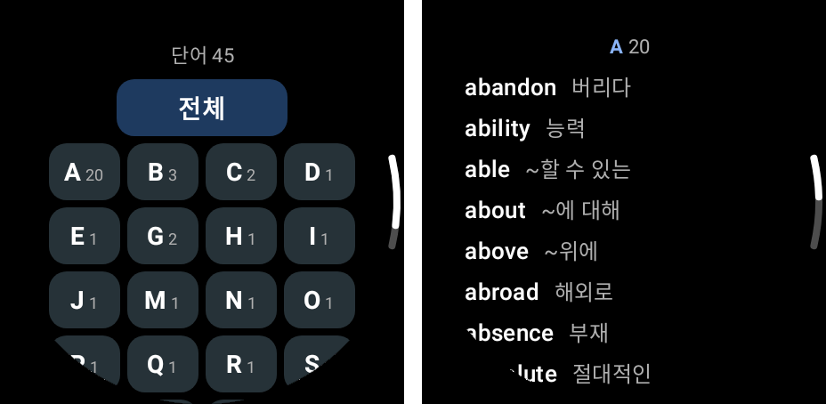

# 워치 단어장 (Galaxy Watch / Wear OS)

폰에서 단어를 넣으면 갤럭시워치에서 알파벳 첫 글자(+두 번째 글자)로 골라 보는 단어장.



## 구성
| 모듈 | 내용 |
|---|---|
| `core` | 붙여넣기 인식, 알파벳 정렬, 첫 글자/두 번째 글자 분류 (순수 Kotlin + 테스트) |
| `mobile` | 폰 앱: 단어 입력, 목록 붙여넣기(미리보기), 수정/삭제, 시계로 자동 전송 |
| `wear` | 시계 앱: 글자 칩 → 단어 목록 (뜻 항상 표시) |

## 폰 앱
- **하나씩 입력**: 영어 / 뜻 → 추가 (키보드 완료 버튼으로도 추가)
- **목록 붙여넣기**: 한 줄에 하나. 아래 형식 모두 인식
  `apple - 사과` · `apple: 사과` · `apple, 사과` · `apple 사과` · `give up 포기하다` · `1. apple 사과` · 엑셀/시트 복사(탭)
  → 추가 전 "새 단어 / 뜻 갱신 / 이미 있음" 미리보기
- 다른 앱에서 텍스트 **공유 → 워치 단어장** 하면 붙여넣기 창이 바로 열림
- 같은 단어는 대소문자 무시하고 하나로 합침 (새 뜻이 있으면 뜻만 갱신)
- 단어 탭 → 수정 / 삭제, 메뉴 → 시계로 다시 보내기 / 전체 삭제

## 시계 앱
- 첫 화면: 단어가 있는 글자만 작은 칩(개수 표시) + `전체`
- 글자를 누르면 바로 그 글자로 시작하는 단어 목록
  (`core/.../WordIndex.kt` 의 `DEFAULT_SPLIT_THRESHOLD` 를 30 등으로 바꾸면 단어 많은 글자만 `Ab Ac …` 두 글자 단계가 생김)
- 단어 목록: 알파벳순, 작은 글씨로 한 줄에 `단어 뜻`
- 베젤/크라운으로 스크롤, 오른쪽→왼쪽 스와이프로 뒤로
- 받은 단어장은 시계에 저장되므로 폰이 없어도 볼 수 있음

## 빌드
```bash
./gradlew :mobile:assembleDebug :wear:assembleDebug
# mobile/build/outputs/apk/debug/mobile-debug.apk  → 폰
# wear/build/outputs/apk/debug/wear-debug.apk      → 시계
./gradlew :core:test                                  # 로직 테스트
./gradlew :wear:testDebugUnitTest -Proborazzi.test.record=true   # 시계 화면 스크린샷 → wear/screenshots
```
Android Studio에서 열어서 폰/시계에 각각 실행해도 됩니다.

## 설치 (갤럭시워치)
폰 앱과 시계 앱은 **같은 컴퓨터에서 빌드한 것(같은 서명)** 이어야 서로 데이터를 주고받습니다.
1. 폰: `mobile-debug.apk` 설치
2. 시계: 설정 → 개발자 옵션 → ADB 디버깅 + 무선 디버깅 켜기
   ```bash
   adb pair <시계IP>:<페어링포트>     # 시계 화면의 페어링 코드 입력
   adb connect <시계IP>:<포트>
   adb -s <시계IP>:<포트> install wear/build/outputs/apk/debug/wear-debug.apk
   ```
3. 폰 앱에서 단어 추가 → 시계 앱 열면 자동으로 받아옴
